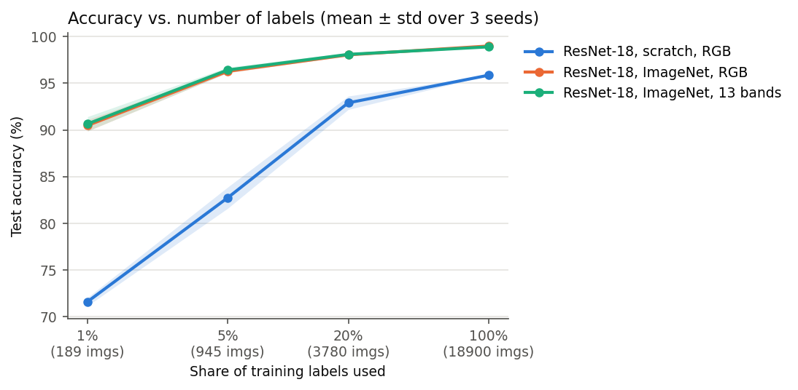
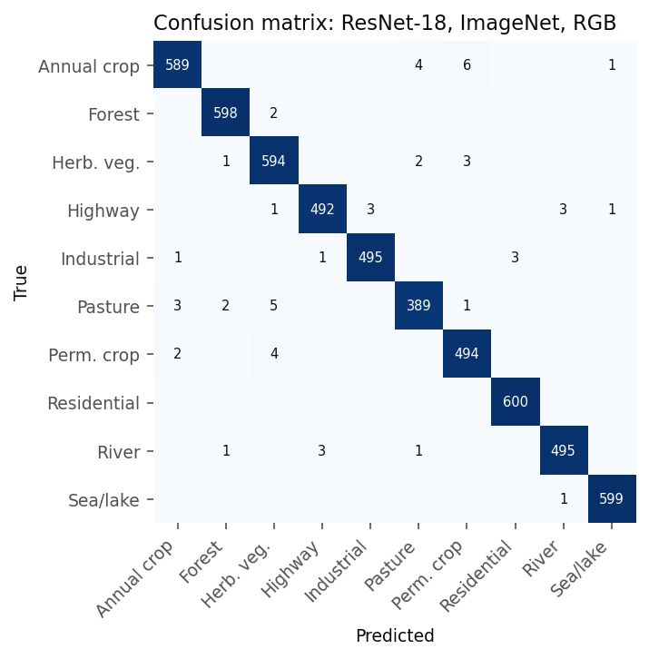
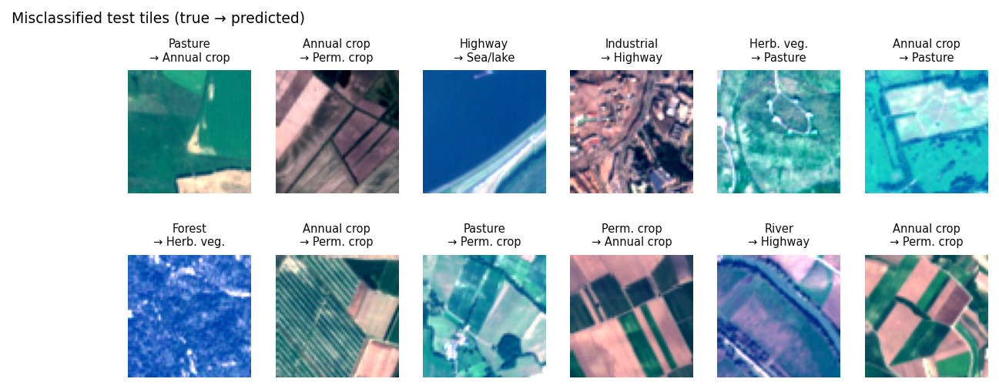

# Land use from Sentinel-2: how much do pretraining and extra spectral bands help?

Classifying 64×64 Sentinel-2 tiles from the [EuroSAT](https://github.com/phelber/EuroSAT) dataset into 10 land-use classes. A fine-tuned ResNet already reaches high accuracy on this benchmark, so the goal here is not one more accuracy number. These experiments test three questions that matter when the labelled data is satellite imagery:

1. **Pretraining.** ImageNet photos look nothing like satellite tiles. Does starting from ImageNet weights still help, and how much more does it help when only a few hundred labelled tiles are available?
2. **Spectral bands.** Sentinel-2 records 13 bands, from visible light to short-wave infrared, but most models use only RGB. Do the other 10 bands improve accuracy, and for which classes?
3. **Symmetry.** An overhead tile has no "up". Rotating or mirroring it gives the same land use, so the 8 symmetries of the square (the dihedral group D4) can be used both for training augmentation and for averaging predictions at test time. How much does that averaging add?

## Data

EuroSAT MS: 27,000 tiles, 10 classes, 13 bands, 10–60 m resolution, from the [official Zenodo release](https://zenodo.org/records/7711810) (MIT licence). RGB models use bands B04, B03 and B02 of the same files, so every comparison is between models that saw exactly the same images.

Split: stratified 70 / 10 / 20 (train / validation / test), seeded and saved in `splits/`. The validation set picks the checkpoint. The test set is used once per run.

## Setup

| Choice | Value | Why |
|---|---|---|
| Models | Small CNN (1.2M parameters), ResNet-18 (11.2M) | A small from-scratch reference, plus a standard architecture that has ImageNet weights |
| 13-band input | First conv rebuilt: RGB filters copied to B04/B03/B02, other bands start at the mean RGB filter, everything scaled by 3/13 | Keeps the pretrained RGB pathway intact and the first layer's activation scale unchanged (`src/models.py`) |
| Normalisation | Per-band mean and std from the training split only | No information from validation or test data |
| Augmentation | Random element of D4 (rotation by k·90°, optional mirror) | Exact symmetries of the task; no interpolation artefacts |
| Optimiser | AdamW, weight decay 0.05, 100 warm-up steps then cosine decay; lr 1e-3 (scratch), 3e-4 (pretrained) | Lower lr so fine-tuning does not erase the pretrained features |
| Budget | 2,000 steps at batch size 128 for every run | Equal compute for every training-set size, so label-efficiency curves compare data, not training time |
| Evaluation | Test accuracy of the best-validation checkpoint, with and without averaging logits over the 8 D4 views | Answers question 3 at no extra training cost |

## Results

All numbers are test accuracy on the same 5,400 held-out tiles. "D4 averaging" means the prediction is averaged over the 8 rotations and mirror images of each tile.

### Full training set

| Model | Params | Test acc. | Test acc. with D4 averaging | Train time (s) |
|---|---:|---:|---:|---:|
| Small CNN, scratch, RGB | 1.2M | 97.41% | 97.80% | 81 |
| ResNet-18, scratch, RGB | 11.2M | 95.15% | 95.85% | 69 |
| ResNet-18, ImageNet, RGB | 11.2M | 98.57% | 98.98% | 70 |
| ResNet-18, scratch, 13 bands | 11.2M | 97.89% | 98.11% | 134 |
| ResNet-18, ImageNet, 13 bands | 11.2M | 98.76% | 98.89% | 130 |

### Label efficiency

Test accuracy (%) with D4 averaging, mean ± standard deviation over 3 seeds. 1% of the labels is 191 training images.

| Model | 1% labels | 5% labels | 20% labels | 100% labels |
|---|---:|---:|---:|---:|
| ResNet-18, scratch, RGB | 71.6 ± 0.4 | 82.7 ± 1.1 | 92.9 ± 0.7 | 95.9 |
| ResNet-18, ImageNet, RGB | 90.5 ± 0.6 | 96.3 ± 0.2 | 98.0 ± 0.1 | 99.0 |
| ResNet-18, ImageNet, 13 bands | 90.6 ± 0.8 | 96.4 ± 0.3 | 98.1 ± 0.2 | 98.9 |



### Where the extra bands help

Per-class recall (%) with D4 averaging.

| Class | Scratch, RGB | Scratch, 13 bands | ImageNet, RGB | ImageNet, 13 bands |
|---|---:|---:|---:|---:|
| Annual crop | 93.3 | 98.3 | 98.2 | 98.3 |
| Forest | 98.5 | 99.0 | 99.7 | 99.8 |
| Herbaceous vegetation | 94.7 | 97.8 | 99.0 | 98.5 |
| Highway | 94.6 | 96.8 | 98.4 | 98.8 |
| Industrial | 97.8 | 98.0 | 99.0 | 99.0 |
| Pasture | 93.5 | 95.5 | 97.2 | 97.5 |
| Permanent crop | 91.2 | 96.8 | 98.8 | 98.0 |
| Residential | 99.0 | 99.3 | 100.0 | 99.3 |
| River | 95.0 | 98.4 | 99.0 | 99.0 |
| Sea/lake | 99.3 | 99.8 | 99.8 | 100.0 |


### Errors

The best model (ImageNet ResNet-18, RGB) gets 55 of the 5,400 test tiles wrong. The most frequent confusions:

| Class pair | Errors (both directions) |
|---|---:|
| Annual crop ↔ Permanent crop | 8 |
| Herbaceous vegetation ↔ Permanent crop | 7 |
| Herbaceous vegetation ↔ Pasture | 7 |
| Annual crop ↔ Pasture | 7 |
| Highway ↔ River | 6 |





## Findings

**1. Pretraining matters most when labels are scarce.** I expected ImageNet weights to help less here, because photos of everyday objects look nothing like satellite tiles. They still help a lot. With only 191 labelled tiles, the pretrained ResNet-18 reaches 90.5% against 71.6% from scratch, a gap of 19 points. The gap shrinks as more labels are added (13.6 points at 5%, 5.1 at 20%, 3.1 with all labels), but it never closes. The spread across seeds is at most about 1 point, so these differences are not noise. For a project where labelling is expensive, this is the most useful result here: a pretrained model with 5% of the labels beats a from-scratch model with all of them.

**2. A small network beats ResNet-18 when both start from scratch.** This surprised me. The 1.2M-parameter CNN reaches 97.8%, and the 11.2M-parameter ResNet-18 only 95.9%. My explanation is the input size: ResNet-18 was designed for 224-pixel photos, and its first layers shrink a 64-pixel tile to 2×2 before classifying it, so a lot of spatial detail is lost early. The small CNN keeps a 4×4 map until the end. Pretraining hides this weakness, since the pretrained ResNet is the best model overall. I haven't tested this explanation yet. Upsampling the tiles, or removing the first downsampling step, would test it directly.

**3. The extra spectral bands help only without pretraining.** From scratch, going from RGB to all 13 bands more than halves the number of errors (224 to 102). The largest gains are on annual crop (+5.0 points), permanent crop (+5.6) and river (+3.4). This fits the physics: vegetation and water look very different in near-infrared, which RGB cannot see. With ImageNet pretraining, the 13-band model is no better than RGB at any amount of labels, and the small differences in both directions (55 vs 60 errors) are within what I would expect from a single run. Two explanations are possible. Pretrained features may already capture most of what the extra bands add. Or the new bands' input weights, which start from an average of the RGB filters, may not have adapted enough in 2,000 steps. The second can be tested by training longer, or by giving the first layer a higher learning rate.

**4. Averaging over rotations and mirror images is a small free gain.** Averaging predictions over the 8 symmetries of the square improves test accuracy in all 32 runs. On the full training set it adds 0.1 to 0.7 points, and up to 3.3 points in the runs with few labels, so it helps most where the model is weakest. It needs no retraining, only 8 forward passes at test time.

**5. The remaining errors are between classes that really do look alike.** Most mistakes are among the four agricultural and vegetation classes (annual crop, permanent crop, pasture, herbaceous vegetation), where a 64×64-pixel tile at 10 m per pixel often shows a mix of land types. The other common one is highway vs river: both appear as a long, thin line across the tile.

## Limitations

- **Spatial leakage.** The split is random over tiles, and EuroSAT tiles cut from the same Sentinel-2 scene can be next to each other. Neighbouring tiles in train and test make the task easier than classifying a new region, so absolute accuracies are probably optimistic. Comparisons between models share the same bias. A geographic split that holds out whole regions would measure that directly.
- **Seeds.** Full-data runs use one seed each. The label-efficiency runs use three, and their spread is shown, so differences smaller than that spread should not be read as real.
- **Training length.** For 4 of the 5 full-data runs, the best validation accuracy came at the very last training step, so those models were still improving when training stopped. All accuracies here are probably slightly below what these models can reach, and the 13-band pretrained model may be the most affected (finding 3).
- **Scope.** One architecture family at the native 64×64 resolution. Upsampling the tiles or using a remote-sensing-pretrained backbone could change the answers.

## Reproduce

Open `notebooks/run_on_colab.ipynb` in Google Colab with a GPU runtime, or locally:

```bash
pip install -r requirements.txt
python -c "from src import data as D; D.download('data')"
python -m src.experiments main     # 5 models, full training set
python -m src.experiments label    # 1%, 5%, 20% of the labels x 3 seeds
python -m src.analysis             # tables -> results/summary.md, figures -> results/figures/
```

A single configuration: `python -m src.train --name my_run --arch resnet18 --pretrained --bands all`.

## Layout

```
src/data.py         download, packing into one memory-mapped array, split, band statistics, D4 maps
src/models.py       small CNN, ResNet-18, 13-band first-layer construction
src/train.py        training loop, evaluation with and without D4 averaging, results JSON
src/experiments.py  the full list of runs
src/analysis.py     tables and figures
splits/             fixed split indices and band statistics
results/            one JSON per run, summary.md, figures/
```

## Reference

P. Helber, B. Bischke, A. Dengel, D. Borth. *EuroSAT: A Novel Dataset and Deep Learning Benchmark for Land Use and Land Cover Classification.* IEEE J-STARS, 2019.
